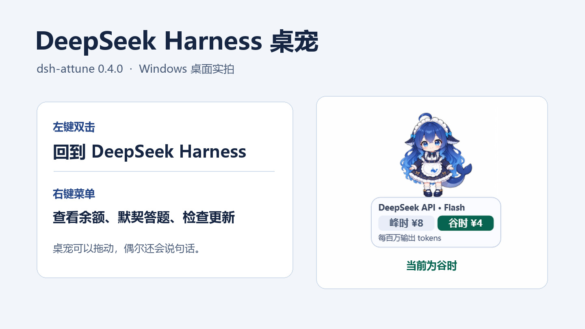
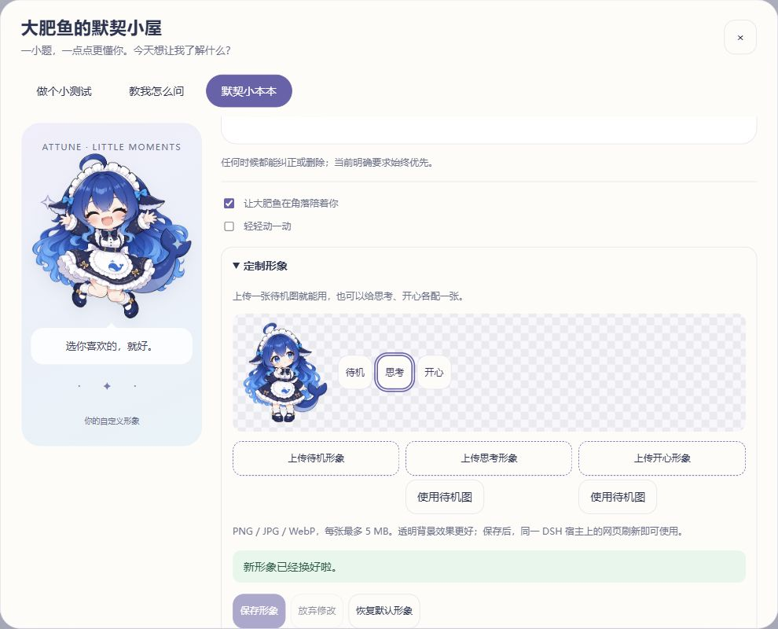

# dsh-attune

[简体中文](README.md) · English

**Help DeepSeek Harness learn how you like to be answered, one quick quiz at a time.**

Open Attune from the DeepSeek Harness sidebar or from its Windows desktop pet's right-click menu. The model you have configured in DSH makes up a question for the moment. You choose an answer, edit what Attune thinks it learned, and decide whether to save it. Saved preferences can guide future replies, and you can correct or remove them in **My preferences**.

## Windows desktop pet

The pet floats on the Windows desktop and can be dragged out of the way. Double-click it to return to DeepSeek Harness. Right-click to check your DeepSeek balance, take a quiz, check for plugin updates, or toggle occasional speech bubbles. The price badge compares DeepSeek Flash output rates in CNY and highlights the active Beijing-time period. [Desktop pet guide](docs/desktop-companion.md)



## What would you rather hear?

Say you tell DSH, “I just had an idea for a game.” Attune might ask which reply you would prefer.

- **A.** “Tell me more. What part of the idea are you most excited about?”
- **B.** “Let's work out what it would take to build a first version.”

If you choose A, you might save “When I share a new idea, help me explore it before we talk about feasibility.” Save it for the brainstorming persona if that is where it fits. When you ask for a review of a finished design, the review persona can still get straight to its feedback.

Some quizzes simply ask whether you want the conclusion up front or the reasoning first, or whether you prefer gentle feedback or a direct critique. **Teach me how to ask** is a separate quiz for Attune's own phrasing, forms of address, and invitations. Preferences saved there apply to future Attune quizzes.

## Install

Install [dsh-attune from npm](https://www.npmjs.com/package/dsh-attune) on the host that runs your DSH session, then restart that host. The package targets the DSH plugin API from 0.2.1-rc.1 through 0.2.x. For the Web profile, run:

```sh
dsh plugin --profile web add dsh-attune@0.4.0
```

- **Official Desktop** has its own plugin manager and `desktop` profile. Use the in-app manager or the `dsh` command supplied by Desktop.
- **DSHA and a local DSH Go engine** use the Web profile selected by the app.
- **Whaleness** uses the copy installed on the host that runs its Mobile Gateway.

Install on each profile where you want Attune available. The standalone DSH CLI delegates plugin management to pnpm, so have pnpm on your `PATH`. For the host and Node requirements, see the [official DSH CLI reference](https://github.com/deepseek-ai/deepseek-harness/blob/master/apps/cli/reference/README.md) and [Desktop documentation](https://github.com/deepseek-ai/deepseek-harness/blob/master/apps/desktop/README.md).

Generating a quiz uses your configured model's quota. You can choose a separate provider and model in the plugin configuration with `generatorProvider` and `generatorModel`.

## Use Attune

### Make a quiz from something DSH said

1. Highlight the relevant lines in a DSH chat or a document preview with selectable text. Right-click and choose **Make a quiz from this selection**. On mobile Web, long-press to select the text and tap the action on the page. You can also open Attune and choose **Make a quiz from pasted text**.
2. Review the excerpt before sending it to the model. Optionally explain what felt off, such as “I was still exploring the idea when it started giving me a schedule.”
3. Choose **Generate a question**, pick the answer that fits, and edit the proposed preference if needed. Choose which personas should use it, then select **Remember this**.
4. To explore a different aspect of the same exchange, choose **Another question from this excerpt**. A set has up to three questions, each covering a different preference.

Whenever you want to start from scratch, open **Attune → Try a test** and describe what you are doing. You can also leave the field blank and let Attune draw on your saved preferences, unexplored topics, and recent quizzes. The six areas are answer order, length, explanations, help when you are stuck, feedback, and creative collaboration.

### Use different preferences in different situations

The built-in personas cover brainstorming (`ideas`), carrying out a plan (`execution`), reviewing work (`review`), and talking through how you feel. DSH uses the current message and a short stretch of recent chat to choose a persona for the turn. General preferences also apply when the situation is unclear, the routing request times out, or the model is unavailable. Your explicit instructions for the current turn take priority.

A quiz suggests a scope, which you can change before saving. Choose one or more personas, or choose **General preferences** to use the rule across situations. When both apply, a persona-specific preference takes priority over a general one of the same kind. A rule shared by multiple personas has one editable entry in **My preferences**. If a persona already has a preference of the same kind, the confirmation screen shows which rules the new choice affects.

Open **Personas** to create, edit, pause, or resume a persona. The delete screen distinguishes preferences used only by that persona from preferences shared with others. You can move exclusive preferences to General or delete them with the persona. After you confirm preferences from at least three separate excerpts, Attune can suggest creating, splitting, or merging personas. The suggestion lists its reasons and the affected rules for you to review.

### Customize your companion

In **My preferences → Customize appearance**, upload an idle image and preview it before choosing **Save appearance**. PNG, JPG, and WebP are supported, with optional images for the thinking and happy states. The companion can move to either side of the DSH window, be hidden, and use gentle animations. See [Custom companion appearance](docs/custom-appearance.en.md) for limits and client support.



### Use slash commands

On a client that exposes host commands, use `/attune` in chat.

| Command | What it does |
| --- | --- |
| `/attune test [situation]` | Generate a quiz for the current situation. |
| `/attune excerpt <text>` | Generate a quiz from a conversation or work excerpt. |
| `/attune tone [feedback]` | Try a quiz about how Attune asks questions. |
| `/attune test list` | List recent questions. |
| `/attune answer <testId> <optionId>` | Submit an answer and review the proposed preference. |
| `/attune remember <proposalId> [personaIds]` | Save a preference. Use comma-separated IDs such as `ideas,review`, or `general`. |
| `/attune reject <proposalId>` | Dismiss a proposed preference. |
| `/attune list` | List saved and pending preferences. |
| `/attune personas` | List persona IDs and their situations. |
| `/attune scope <ruleId> <personaIds>` | Change where a saved preference applies. |
| `/attune persona-review` | Review suggestions about creating, splitting, or merging personas. |
| `/attune correct <ruleId> <new text>` | Edit a saved preference. |
| `/attune delete <ruleId> [forget]` | Delete a preference. Add `forget` to remove its supporting answer too. |

Use `/attune on` to allow occasional quiz recommendations when you open Attune, and `/attune off` to turn them off. Recommendations are at least 72 hours apart and appear at most twice in any seven-day period.

## Where it works

| Client | Attune entry points | Verification |
| --- | --- | --- |
| DSH Web | Responsive panel, in-window companion, and slash commands | npm install and removal checked on Windows and Linux with DSH 0.2.2-rc.1. Quiz and preference flow exercised on Linux with the official DeepSeek API. |
| Official DSH Desktop | Attune sidebar, slash commands and a Windows desktop pet | The Windows pet was verified to load in Desktop 0.2.2-rc.5. |
| DSH Go, local engine | Native panel when the bridge is available, plus Web and slash-command options | Panel schema and a simulated bridge tested. Physical-device testing is pending. |
| DSH Go, SSH or relay | Slash commands. The Web panel depends on the connection mode. | Protocol reviewed. Physical-device testing is pending. |
| DSHA | Standard Web UI and commands in its bundled DSH engine | Physical-device testing is pending. |
| Whaleness for Android and iOS | Host-provided slash commands through Mobile Gateway | Gateway and App testing is pending. |

See [DSH Go and other mobile clients](docs/dsh-go.en.md) for the client-specific entry points.

### Test with the official DeepSeek API

In the documented 0.1.0 test, Linux DSH Web 0.2.2-rc.1 ran on an H100 server and made requests to the official DeepSeek API using `deepseek-flash`. Three test situations generated two-choice quizzes in 1.9, 2.2, and 2.7 seconds.

The requests showed the preference entering the next conversation only after it was confirmed. A correction changed the assistant's opening and prompted it to give a concrete example. Deleting the rule with **Also forget the answer that supported this rule** removed the rule and its source answer from the archive. The test also checked duplicate answers, rejected proposals, and the recommendation cooldown.

## Data and removal

- Quizzes, answers, proposed preferences, and confirmed rules are stored on the DSH host. The default file is `$DSH_HOME/storages/dsh-attune/state.json` or `~/.dsh/storages/dsh-attune/state.json` when `DSH_HOME` is unset. If you set `dataDir`, look for `state.json` in that directory.
- Attune sends an excerpt and optional feedback to the configured model when you generate the quiz. The archive stores the generated quiz and its learning evidence. For ordinary chats, Attune adds up to eight applicable confirmed rules within a 900-character context budget.
- Clients connected to one host share that host's profile data. A local phone engine and a separate computer host each have their own archive. Attune is designed for one user per host.

To uninstall from Web, run the following command on the host and restart DSH.

```sh
dsh plugin --profile web remove dsh-attune
```

For another profile, use its name. For official Desktop, use the in-app plugin manager, or launch Desktop once to initialize its profile, quit it fully, and run `dsh plugin --profile desktop remove dsh-attune` with the CLI that Desktop installed. Reopen Desktop afterward.

To erase stored preferences as well, stop the hosts using the same archive and confirm the actual data directory before removing the plugin's files. Profiles on the same host may share the archive.

## Development and credits

```sh
npm test
npm pack --dry-run
```

The code is released under the [MIT License](LICENSE). The bundled whale-maid artwork comes from [SlimeNull and the Chubby Whale contributors](https://github.com/SlimeNull/ChubbyWhale) and is distributed under CC BY-NC-SA 4.0. See the [artwork notice](ASSETS-NOTICE.md) for full attribution. [dsh-novel-craft](https://github.com/shiyan688/dsh-novel-craft) inspired the workflow of turning a small choice into an editable rule for future context.
