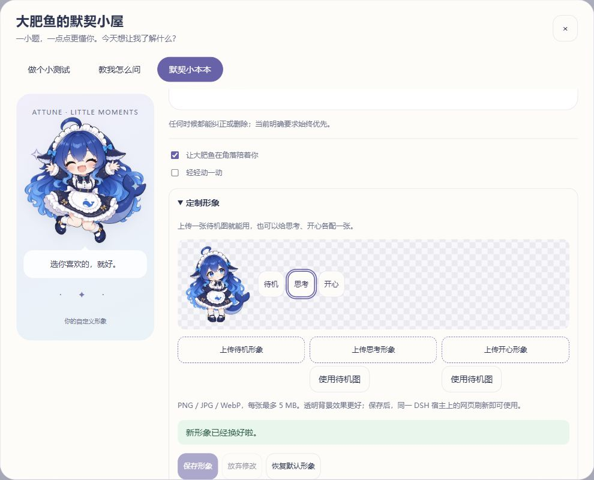

# dsh-attune · 大肥鱼的默契小屋

**偶尔玩一道趣味小测试，让你的 DSH 大肥鱼越来越懂你。**

闲下来，点点角落里的大肥鱼女仆，陪她玩一道默契题。题目由 DSH 根据聊天情境临时生成：可以像网上的心理小测试一样，从日常情境了解你；也可以直接问，你喜欢怎样被回应。

选完以后，先看看她有没有理解对，再决定记不记住。你确认过的偏好会用于后续聊天，让大肥鱼慢慢找到和你相处的方式。小本本里的每一条都能纠正、删除，也能一起忘记答题依据。

## 了解你喜欢怎样被回应

### 像网上的趣味心理小测，从一个日常情境聊起

比如，你兴冲冲地说：「我突然想到一个新点子！」

你更期待大肥鱼怎样回应？

- **A**「快说说！最让你兴奋的是哪一部分？」
- **B**「我们一起看看它能解决什么问题、怎么做出来。」

如果选 A，可以先确认一条偏好：

> 分享新点子时，先陪我展开想法，再聊可行性和具体步骤。

以后说「我想做个自己的小游戏」，大肥鱼就可以先和你聊最想做出的玩法和体验，再一起梳理计划。偶尔随手选一题，下一次交流就能少解释一点。

### 直接问你喜欢的沟通方式

有时也可以问得简单一点：

- 「你喜欢我先给结论，还是先讲原因？」
- 「提建议时，你更喜欢温和一点，还是直接说主要问题？」

这些问题同样由 DSH 结合聊天情况临时生成。选完先生成候选偏好，你可以改成自己的说法，再决定要不要记进小本本。

接下来，我也想把这种了解延伸到情感支持：当你分享烦心事时，更希望先被倾听，还是一起理清思路？把这些期待慢慢说清楚，让大肥鱼更知道怎样回应你。

## 0.2.1 · 换上你喜欢的形象

这次给小屋加上了女仆桌宠、轻动画、「教我怎么问」语气学习，也开放了自定义形象上传。可以陪大肥鱼玩小测试，也可以换成自己喜欢的角色。

- **角落里的大肥鱼**：点开进入小屋，可收起、左右换位置；待机轻摆、出题歪头、确认后开心跃起。动画可关闭，也遵循系统减少动态效果设置。
- **定制形象**：上传自己的 PNG、JPG 或 WebP 图片，预览后保存；待机形象必选，也可单独配上思考和开心形象。未配表情时继续使用自己的待机图。形象保存在 DSH 宿主，可恢复默认。详见[定制形象](docs/custom-appearance.md)。
- **教我怎么问**：题目由当前 DSH 模型临时创作，了解你喜欢的语气、称呼和邀请方式。选择只产生候选；确认后，下次出题才参考它。「主人」也是可选偏好。语气规则可在小本本纠正、删除。
- **两种偏好各有用途**：普通偏好用于 DSH 的相关对话；「我的提问语气」只用于本插件生成题目，不注入普通 DSH 对话。图形和文字入口共用确认与遗忘逻辑。

### 上传自己的形象

打开**默契小屋 → 默契小本本 → 定制形象**，选择一张待机图，预览后点击「保存形象」即可。支持 PNG、JPG、WebP，也可以分别上传思考、开心表情；只用一张图也能配合小屋的轻动画。修改时可以放弃，想换回女仆时点击「恢复默认形象」。连接同一个 DSH 宿主的电脑和手机 Web 页面，刷新后就能看到同一套形象。



完整步骤、图片大小和各端入口见[自定义形象说明](docs/custom-appearance.md)。

电脑 Web/标准 Desktop 插件页面显示**DSH 窗口内桌宠**；手机 Web 使用紧凑角色区和全屏小屋。DSH Go 原生面板提供语气测试及角色状态文案，界面能力由客户端决定。DSHA、Whaleness 在加载标准 Web 插件时使用同一界面，其余入口保留 `/attune` 命令。此版没有创建 Windows 系统桌面窗口或手机跨 App 悬浮窗，各原生客户端仍需真机验收。参见 [移动端接入说明](docs/dsh-go.md)。

女仆素材来自 [SlimeNull / Chubby Whale](https://github.com/SlimeNull/ChubbyWhale)，图片按 CC BY-NC-SA 4.0 分发，代码沿用 MIT。署名与素材范围见 [ASSETS-NOTICE.md](ASSETS-NOTICE.md)。素材随包提供，展示时不访问图片 CDN。

每道题由 DSH 当前配置的模型临时生成，参考当前情境、已确认偏好、尚未摸清的维度和最近的题目。生成器会检查两种选项是否落在同一偏好维度、是否对应可执行的规律。当前已覆盖回答顺序、长度、解释方式、卡关时的帮助、反馈方式和创意偏好六种沟通与协作偏好。

## 安装

DSH 0.2.1-rc.1 至 0.2.x 的插件接口为目标。0.1.0 已在 Windows 和 Linux 的 DSH 0.2.2-rc.1 Web profile 验证 npm 安装和卸载，真模型测试见下文。运行新版 DSH 时以其自身 Node 要求为准。插件使用 JavaScript、JSON 和 WebP 图片，无安装脚本或原生模块。生成小测试会调用你在 DSH 中配置的默认模型，产生相应模型用量；也可在插件配置中设置 `generatorProvider`、`generatorModel`。

在实际运行会话的 DSH 宿主上从 [npm](https://www.npmjs.com/package/dsh-attune) 安装本包，并重启宿主：

```text
dsh plugin --profile web add dsh-attune@0.2.1
```

官方 Desktop 使用它自己的插件管理页，或用 Desktop 自带命令安装到 `desktop` profile。DSHA、DSH Go 手机本机引擎安装到其实际使用的 `web` profile；Whaleness 使用电脑宿主上的安装。安装到一个 profile 不会自动启用其他 profile。

## 卸载与数据

在安装插件的 DSH 宿主上，按实际使用的 profile 移除。例如 Web profile：

```text
dsh plugin --profile web remove dsh-attune
```

操作后重启该宿主。`dsh plugin` 会将命令交给 pnpm；普通 CLI 需要 pnpm 在 PATH 中。其他 profile 需将 `web` 换成实际名称。Windows 上已在 DSH 0.2.2-rc.1 的隔离 Web profile 验证安装与卸载。

官方 Desktop 可使用应用中的插件管理页移除。使用命令行时，需先至少启动一次 Desktop 以初始化 profile，然后完全退出 Desktop；使用由 Desktop 安装的 `dsh` 命令运行 `dsh plugin --profile desktop remove dsh-attune`，再重新打开 Desktop。普通 npm 版 `dsh` 不能管理 Desktop profile；具体 Desktop 版本与本插件的实机操作仍待验。详见 [DSH 官方 CLI](https://github.com/deepseek-ai/deepseek-harness/blob/master/apps/cli/reference/README.md) 和 [Desktop 文档](https://github.com/deepseek-ai/deepseek-harness/blob/master/apps/desktop/README.md)。

卸载插件不会自动删除偏好档案。默认文件为 `$DSH_HOME/storages/dsh-attune/state.json`；未设置 `DSH_HOME` 时，默认位于用户主目录的 `.dsh/storages/dsh-attune/state.json`。若配置过 `dataDir`，则位于该目录下的 `state.json`。如需彻底清除，请先停止使用同一档案的 DSH 宿主，核对实际路径后自行删除该插件数据；同一宿主上的其他 profile 可能共用它。


## 怎么用

电脑 Web、官方 Desktop 和加载标准 Web 插件的移动页面，打开侧栏底部的“🎲 默契”面板，可以填一句眼前在忙的事，再点“生成一题”。不填写时，DSH 根据已有偏好和未知维度出题。选项会生成带来源的候选偏好；确认后立即能在偏好页看到它。纠正时直接修改文字；删除时可选择“同时忘记答题依据”。新偏好从下一次模型请求开始使用。

原生手机客户端可以使用文字命令：

```text
/attune test [眼前情境]              # 按当前会话与情境生成新题
/attune tone [想调整的问法]          # 让插件了解你喜欢的提问语气
/attune test list                    # 查看最近生成的题
/attune answer <题目ID> <选项ID>      # 提交答案
/attune remember <候选ID>            # 确认偏好
/attune reject <候选ID>              # 不采纳
/attune list                         # 查看已确认与待确认偏好
/attune correct <规则ID> <新文字>     # 纠正
/attune delete <规则ID>              # 删除规则
/attune delete <规则ID> forget       # 同时忘记来源证据
```

`/attune on` 开启“打开默契页时偶尔推荐一道题”，`/attune off` 关闭。推荐至少间隔 72 小时、每七天最多两次。它不会主动发送手机系统通知，也不会在宿主关闭时补发。

同一 DSH 宿主上的手机与电脑共享档案。手机本机引擎和另一台电脑宿主各有自己的档案。默认按单主人宿主设计；共享同一宿主访问凭据的多人尚不能得到可靠的个人档案隔离。

## 已实现的接入方式

| 入口 | 首版能力 | 验收状态 |
|---|---|---|
| DSH Web、官方 Desktop | 响应式卡片、规则管理、文字命令、上下文偏好 | Windows 和 Linux 已验证 npm 安装与卸载，Linux 已通过 DeepSeek 官方 API 出题和偏好流程实测，Desktop 应用待实机验收 |
| DSH Go 手机本机 | 原生面板答题、确认、拒绝；文字命令纠正与删除；也可用 Web 界面 | 对照 DSH Go JSON Schema 和模拟桥接测试；真机待验 |
| DSH Go SSH、中转 | 文字命令；网页岛仅在接入模式允许时使用 | 协议分析通过；真机待验 |
| DSHA | 使用内置 DSH 的 Web 插件和文字命令 | 真机待验 |
| Whaleness Android/iOS | 走宿主下发的 `/attune` 文字命令 | Gateway/App 真机待验；Web 插件界面未作为原生能力 |

各手机模式的依据和测试清单见 [DSH Go 与手机端接入](docs/dsh-go.md)。客户端界面是否会显示，取决于手机 App 所支持的插件 UI 协议；宿主能安装插件不等于原生 App 自动显示网页面板。

### H100 服务器实测

从 npm 安装 `dsh-attune@0.1.0` 后，在 H100 服务器上用 Linux DSH Web（0.2.2-rc.1）连接 DeepSeek 官方 API，模型选用 `deepseek-flash`。讲解实验复现、审阅志愿者招募公告、处理投屏故障这三个情境各生成了一道二选一题，出题接口耗时分别为 1.9、2.2 和 2.7 秒。比如，演示时投屏突然黑屏，题目会问你想先拿到一个能立刻试的步骤，还是先定位原因。

我核对了实际发给模型的聊天请求。答题后，插件先把结果存为候选，确认后的聊天请求才会带上这条偏好。把规则改成先用「蓝舟演示」开场、再举个例子后，模型用这个短语开场，并给出了具体例子。删除规则时选择忘记答题依据，规则和来源答案都从偏好档案里移除，新会话的请求也不再带上这条偏好。重复答题去重、拒绝候选和邀请冷却也通过了测试。

## 数据与边界

- 生成题目、答案、候选和已确认规则存于当前 DSH 宿主的 `$DSH_HOME/storages/dsh-attune/state.json`；配置 `dataDir` 可指定其他绝对目录。文件以原子替换和跨进程锁更新。生成题目会短暂使用当前会话最近的直接对话或用户提供的情境，模型请求限长；完整会话不会写入偏好档案。
- 只有已确认的规则会进入 DSH 后续请求的动态上下文，每次至多 8 条、900 字符。原始答题记录不会整个进入普通对话。
- 一次选择只生成待确认规律；已有规律若被反向答案挑战，会显示旧规律，用户确认后才替换。
- 当前没有跨独立宿主的自动同步，也没有针对原生手机 App 的推送或通知栏入口。
- 出现数据格式不兼容或损坏时，插件保留原文件并报错，不会用空档案覆盖。

## 开发验证

```text
npm test
npm pack --dry-run
```

测试覆盖动态题目校验、完整答题闭环、冲突与强化、重复提交、并发写入、邀请频控、认证 API、动态上下文、文字命令、DSH Go 桥接和 Web/Desktop 地址解析。许可证为 MIT。原项目 [dsh-novel-craft](https://github.com/shiyan688/dsh-novel-craft) 的“简单判断→可编辑规律→轻量上下文”是产品思想来源；本插件代码独立编写。
