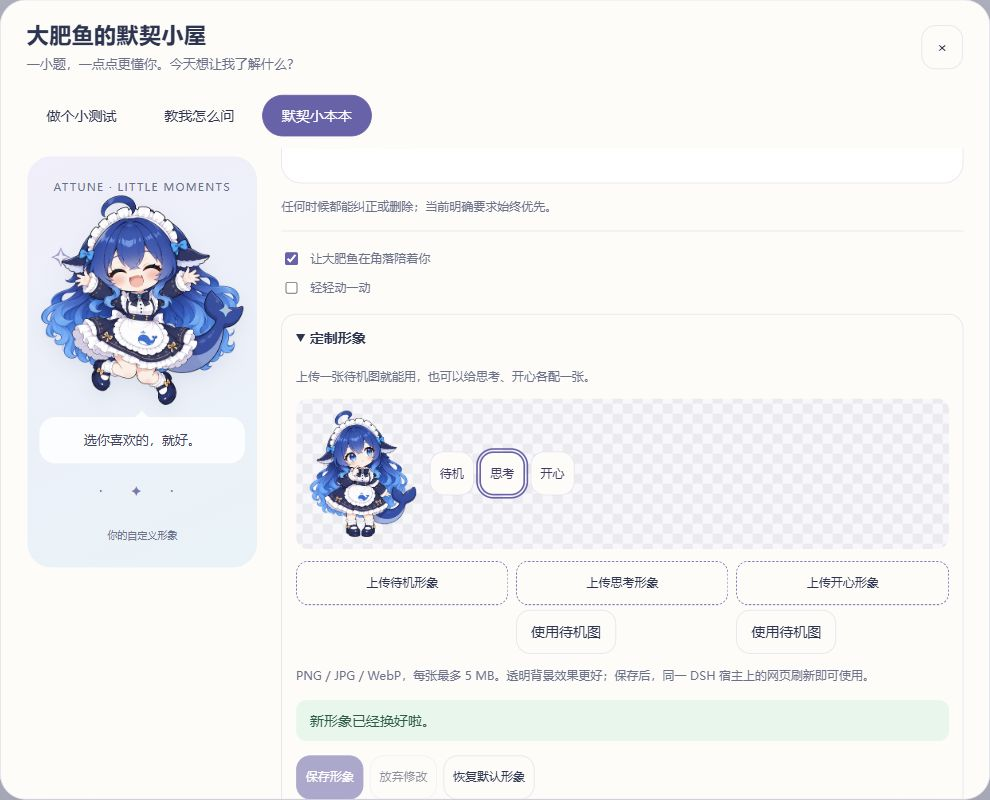

# Custom companion appearance

[简体中文](custom-appearance.md) · [English README](../README.en.md)

From Attune, open **My preferences → Customize appearance** to change the companion in the corner and in the quiz panel.

## Upload and save

1. Select **Upload idle appearance** and choose a PNG, JPG, or WebP from your device. A transparent background works well for the companion.
2. Check the preview. Use **Upload thinking appearance** and **Upload happy appearance** if you want different expressions for quiz generation and confirmation. With one idle image, Attune uses it for each state.
3. Choose **Save appearance** to apply your changes, or **Discard changes** to close the preview without saving.
4. Use **Restore default appearance** to get the whale maid back. This action updates the appearance file only.

Each source image can be up to 5 MiB and 4,096 pixels in either dimension. The Web editor scales it proportionally to a maximum of 768 pixels on its longest side and saves it as a PNG, with a limit of 512 KiB per saved image. Animated WebP is treated as a still image. Attune supplies the companion's movement, and you can disable **Gentle animations** or use your system's reduced-motion setting.

## Where images are saved

The current DSH host stores them in `appearance.json` in the plugin's data directory. Refresh any other Web client connected to that host to use the same images. Companion position, visibility, and animation preferences are local to each client. Uploaded images are used for display.

## Client support

| Client | Where to customize |
| --- | --- |
| DSH Web and Desktop with the standard Web plugin | Open Attune and use the file picker under **Customize appearance**. |
| Mobile browser and DSHA with the standard Web UI | Use the same screen. The browser or WebView provides its file or photo picker. |
| DSH Go | Use the plugin's Web panel when the app exposes it. The native JSON panel supports quizzes and preference actions. |
| Whaleness and command-only clients | Open the DSH Web page connected to the same host to customize the companion. |

The [DSH Go Web panels guide](https://github.com/ccch1mneyyy/dsh-Go/blob/main/docs/plugins/web-panels.md) describes how to open the plugin's in-app Web page. Availability depends on the engine, bridge, and app version. If the app offers **Open in the browser**, that entry point can also be used. See [DSH Go and other mobile clients](dsh-go.en.md) for details.

## Verification

The 0.2.1 checks covered selecting all three images in a browser, previewing them, saving, refreshing, and restoring the defaults. The same flow was checked in a 390 × 844 viewport and against an isolated DSH Web host, including authenticated access. File pickers in the native mobile apps are pending physical-device testing.
