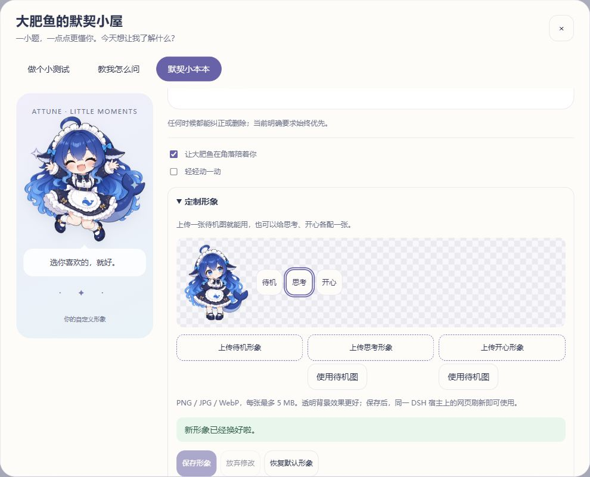

# 定制自己的桌宠形象

[English](custom-appearance.en.md)

0.2.1 开放了自定义形象上传。在默契小屋的「默契小本本」里打开「定制形象」，可以给角落桌宠和测试小屋换上自己的角色。



## 上传与保存

1. 点击「上传待机形象」，从相册或文件中选择一张 PNG、JPG 或 WebP 图片。透明背景图适合做桌宠。
2. 查看预览。还可以用「上传思考形象」「上传开心形象」分别设置出题时和确认偏好后的表情；这两张是可选的。只上传一张待机图时，所有状态都沿用自己的角色，并配合轻动画。
3. 点击「保存形象」，保存成功后，小屋和角落桌宠使用新形象。选图预览阶段还没有覆盖宿主中已保存的形象。
4. 想换回来时，点击「恢复默认形象」。测试记录、普通偏好和提问语气偏好继续保留。

单张原图最大 5 MiB，宽高各不超过 4096 像素。界面会等比例缩小到最长边不超过 768 像素，转成 PNG 后保存；每张保存图最多 512 KiB。图片太大、无法解码或格式不支持时会显示提示，可重新选择。动态 WebP 会作为静态图片处理，角色动作由小屋自己的轻动画呈现。

## 保存在哪里

形象独立保存在当前 DSH 宿主插件数据目录的 `appearance.json`。连接同一宿主的其他 Web 界面，刷新页面后可读取该形象；不同宿主各自保存。共享同一宿主的用户也共享这套形象。

桌宠位置、显隐和动画开关仍是各终端自己的设置。上传的图片用于界面展示，不会作为小测试材料发送给模型。

## 各端入口

| 界面 | 如何定制 |
| --- | --- |
| 电脑 DSH Web、加载标准 Web 插件的 Desktop 界面 | 打开小屋，进入「定制形象」，使用文件选择器 |
| 手机浏览器、DSHA 的标准 Web UI | 使用同一个入口；由浏览器或 WebView 打开相册／文件选择器 |
| DSH Go | 当前插件的原生 JSON 面板尚未接入图片选择与自定义形象展示；可使用 App 提供的插件 Web 界面入口，具体 WebView 文件选择行为仍需真机验证 |
| Whaleness 等只呈现原生聊天／文字命令的入口 | 保留测试与偏好管理；定制形象使用同一宿主的 DSH Web 页面 |

DSH Go 的新版[网页面板说明](https://github.com/ccch1mneyyy/dsh-Go/blob/main/docs/plugins/web-panels.md)提供插件详情「App 内界面」入口，其中侧栏底部按钮可打开整页 Web 岛，聊天页浮层需逐插件启用。是否可用取决于本机引擎、桥接和客户端版本；失败时使用 App 显示的「在网页版打开」。插件不构造未定义的深链地址。

DSH Go 已有需协商的原生 `files` / `pickImage` 能力，见[选择文件与图片](https://github.com/ccch1mneyyy/dsh-Go/blob/main/docs/plugins/files.md)。本次使用 Web 上传入口，未把所有原生端标记为已支持。

## 0.2.1 验证记录

2026-11-17 完成以下验证：

- 45 项自动测试通过，覆盖原有偏好与提问语气闭环，以及图片格式、尺寸、大小、保存、并发写入与恢复默认。
- 浏览器真实文件选择器完成待机、思考、开心图片上传，预览、保存、刷新恢复和恢复默认；390 × 844 视口下检查了操作与布局，无横向溢出。
- 将安装包加入独立的官方 DSH Web 配置，真实宿主通过读取、上传三种形象、重新读取、恢复默认和访问鉴权检查；换图前后的偏好数据一致。

电脑和手机 Web 共用这套上传界面。390 像素视口检查不等同于手机真机验收；DSH Go、DSHA、Whaleness 原生客户端的文件选择器尚未完成真机验证。

安装或更新到 0.2.1 后，重启 DSH 宿主并刷新网页，即可使用形象上传入口：

```text
dsh plugin --profile web add dsh-attune@0.2.1
```
